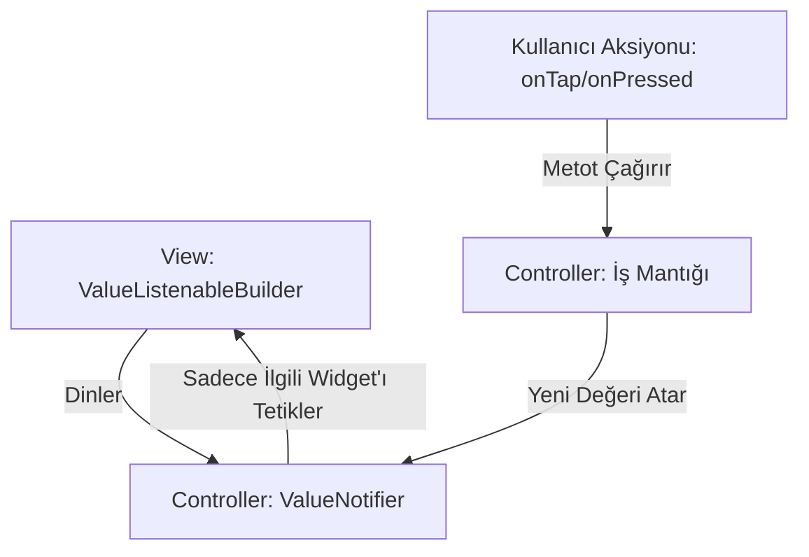

# Reaktif State Akış Mimarisi (ValueNotifier)

Bu projede state yönetimi doğrudan Flutter'ın yerel `ValueNotifier` ve `ValueListenableBuilder` bileşenleri ile yönetilir.

### Avantajları:
1. Sayfanın tamamının (`setState` gibi) gereksiz yere baştan çizilmesini önler.
2. Harici ağır paket bağımlılığını sıfıra indirir.
3. Test edilebilirliği ve kod ayrışımını (Separation of Concerns) artırır.
