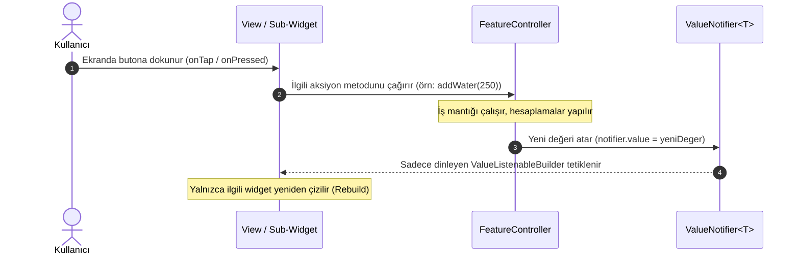

# Reaktif State Akış Mimarisi (ValueNotifier & ValueListenableBuilder)

Bu kılavuz, projede benimsenen yerel, hafif ve yüksek performanslı `ValueNotifier` reaktif state mimarisini ve yaşam döngüsünü açıklar.

---

## 1. Mimari Genel Bakış

Projede ağır harici state yönetimi kütüphaneleri (Bloc, Riverpod, MobX vb.) yerine Flutter'ın yerel çekirdek API'ları olan `ValueNotifier<T>` ve `ValueListenableBuilder<T>` kullanılır.

Bu mimari ile:
- Sayfa düzeyinde devasa `setState()` çağrıları tamamen engellenir.
- Yalnızca değeri değişen alt bileşen (widget) yeniden çizilir (rebuild).
- İş mantığı (Controller) arayüz katmanından (View/Widget) kesin sınırlarla ayrılır.
- Kodlar saf Dart olarak kolayca birim testlerine (Unit Test) tabi tutulur.

---

## 2. Reaktif Veri Akış Şeması (Mermaid)



---

## 3. Temel Uygulama Prensipleri

### A. Controller Katmanı
Controller sınıfı, görünümden bağımsız iş mantığını ve durum bildirimlerini tutar.

```dart
import 'package:flutter/foundation.dart';
import '../models/water_log_model.dart';

class WaterTrackerController {
  // 1. Reaktif Değer Bildiricileri (State Notifiers)
  final ValueNotifier<int> currentWater = ValueNotifier<int>(0);
  final ValueNotifier<List<WaterLog>> logs = ValueNotifier<List<WaterLog>>([]);
  final ValueNotifier<bool> isLoading = ValueNotifier<bool>(false);

  // 2. Sabit ve Hesaplanmış Özellikler (Getters)
  final int dailyGoal = 2500; // ml

  double get progressRatio => (currentWater.value / dailyGoal).clamp(0.0, 1.0);
  int get remainingWater => (dailyGoal - currentWater.value).clamp(0, dailyGoal);

  // 3. İş Mantığı Metotları (Actions)
  void addWater(int amount) {
    if (amount <= 0) return;

    currentWater.value += amount;

    final newLog = WaterLog(
      id: DateTime.now().millisecondsSinceEpoch.toString(),
      amountMl: amount,
      timestamp: DateTime.now(),
    );

    // DİKKAT: Listelerde referans değişimi tetikleme için şarttır!
    logs.value = [newLog, ...logs.value];
  }

  void resetWater() {
    currentWater.value = 0;
    logs.value = [];
  }

  // 4. Bellek Temizliği (Dispose)
  void dispose() {
    currentWater.dispose();
    logs.dispose();
    isLoading.dispose();
  }
}
```

### B. View ve Dinleme (ValueListenableBuilder) Katmanı
View sınıfı `StatelessWidget` olarak kalır ve yalnızca dinlenmesi gereken küçük parçaları `ValueListenableBuilder` ile sarar:

```dart
ValueListenableBuilder<int>(
  valueListenable: controller.currentWater,
  builder: (context, waterAmount, child) {
    return Text(
      '$waterAmount ml',
      style: Theme.of(context).textTheme.headlineMedium,
    );
  },
)
```

---

## 4. İleri Düzey Senaryolar ve Kritik Kurallar

### 1. Liste ve Koleksiyonlarda State Güncelleme (Immutability)
`ValueNotifier`, değerin bellekteki referansı değiştiğinde (`value != previousValue`) dinleyicilerini uyarır. Doğrudan listeye `add()` yapmak dinleyicileri tetiklemez:

```dart
// YANLIŞ KULLANIM (UI güncellenmez):
logs.value.add(newLog);

// DOĞRU KULLANIM (Yeni liste referansı oluşturulur ve UI anında tetiklenir):
logs.value = [newLog, ...logs.value];
```

### 2. Birden Fazla Notifier'ı Birlikte Dinleme (`Listenable.merge`)
Eğer bir arayüz bileşeni iki farklı bildiriciye bağımlıysa, iç içe `ValueListenableBuilder` yazmak yerine `Listenable.merge` ile `AnimatedBuilder` kullanılabilir:

```dart
AnimatedBuilder(
  animation: Listenable.merge([controller.currentWater, controller.logs]),
  builder: (context, _) {
    return Column(
      children: [
        Text('Toplam: ${controller.currentWater.value} ml'),
        Text('Kayıt Sayısı: ${controller.logs.value.length}'),
      ],
    );
  },
)
```

### 3. Asenkron Durum Yönetimi (Loading, Success, Error)
Asenkron işlemlerde `isLoading` bildiricisi kullanılır:

```dart
Future<void> syncWithServer() async {
  isLoading.value = true;
  try {
    // API veya veritabanı simülasyonu
    await Future.delayed(const Duration(milliseconds: 600));
  } finally {
    isLoading.value = false;
  }
}
```

---

## 5. Yaşam Döngüsü ve Bellek Sızıntılarını (Memory Leak) Önleme

1. **Her Controller bir `dispose()` metoduna sahip olmalıdır.**
2. Eğer Controller `StatefulWidget` içinde başlatılıyorsa `State.dispose` içinde `controller.dispose()` çağrılmalıdır.
3. Eğer Controller uygulama düzeyinde (App-scope / Singleton) yaşıyorsa uygulama kapanana kadar açık kalır.
4. `ValueNotifier` kapatıldıktan (`dispose`) sonra kesinlikle yeni değer ataması yapılmamalıdır.

---

## 6. Mimari Karşılaştırma Matrisi

| Kriter | Devasa `setState` | `ValueNotifier` (Bizim Tercihimiz) | Harici Paketler (Bloc/Riverpod) |
| :--- | :--- | :--- | :--- |
| **Yeniden Çizim Kapsamı** | Bütün ekran baştan çizilir | Yalnızca `ValueListenableBuilder` altı | Seçili widgetlar |
| **Paket Bağımlılığı** | Yok (Yerel) | Yok (Yerel & Sıfır Bağımlılık) | Yüksek sürüm bağımlılığı |
| **Öğrenme ve Bakım** | Kolay fakat spagetti koda açık | Kolay, temiz ve ayrık mimari | Yüksek boilerplate kod yükü |
| **Birim Test Kolaylığı** | Zor (Widget test gerekir) | Çok Kolay (Saf Dart testi) | Orta (Paket test araçları gerekir) |
| **Performans & FPS** | Düşük (Gereksiz render) | Çok Yüksek (İzole render) | Yüksek |
