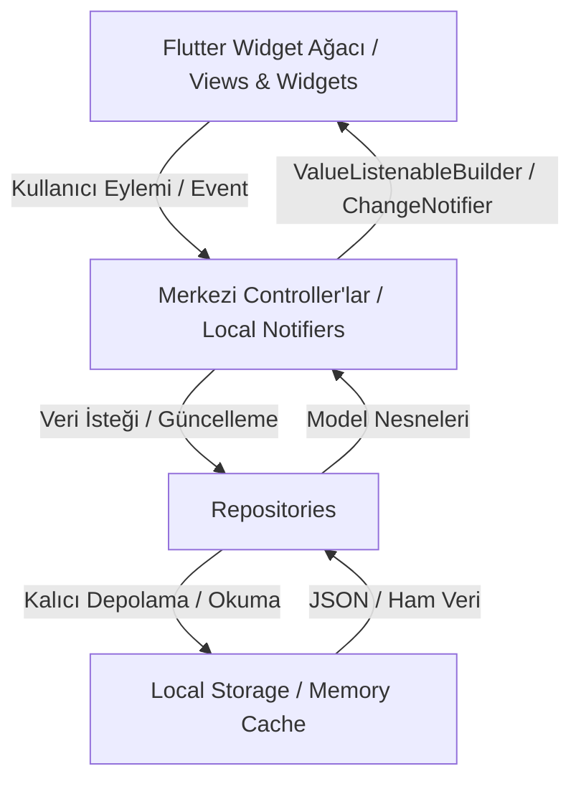

# Tutturdum - Durum Akışı ve Mimari Referansı (State Flow)

Bu doküman, Tutturdum uygulamasındaki durum yönetimi (State Management) mekanizmasını, veri akışını ve controller yaşam döngüsünü açıklar.

## 1. Mimari Akış Şeması

## 2. Merkezi Durumlar (Global State)
- **ThemeController:** `themeMode` (`system`, `light`, `dark`). Uygulama genelinde anlık tema değiştirir ve kalıcı olarak saklar.
- **WalletController:** `balance` (double - sanal bakiye). Tüm ekranlar (Günün Bülteni, Kupon Oyna, Sepet, Profil, Kart Bilgisi) tek bir sanal bakiye değerini paylaşır.
- **CouponCartController:** `items` (List<CouponSelection>), `stake` (double), `totalOdds` (double), `possibleWin` (double). Alt sekmeler arası geçişte sepet sıfırlanmaz. Minimum 50 TL kontrolü burada yapılır.
- **AuthController:** `currentUser` (User?), `isAuthenticated` (bool). Giriş/çıkış ve demo kullanıcı oturumunu yönetir.
- **NotificationController:** `notifications` (List<NotificationItem>), okunmamış sayısı.
- **CouponHistoryController:** Oynanan kuponların geçmiş kayıtlarını tutar.

## 3. Reaktivite Kuralı
- `ValueNotifier<T>` ve `ValueListenableBuilder<T>` kullanılır.
- Liste güncellemelerinde `listNotifier.value = List.from(listNotifier.value)` şeklinde yeni referans atanarak tetikleme sağlanır.
- Büyük sayfalarda bütün ekranı `setState` ile yeniden çizmekten kaçınılır.
